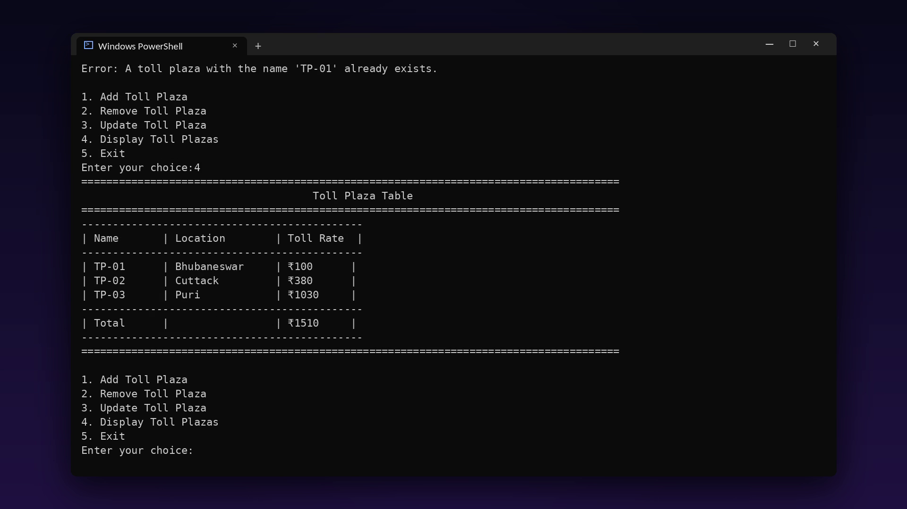
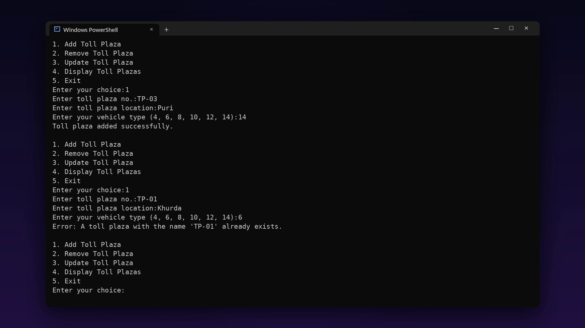

# 🛣️ Toll Plaza Management Service

A command-line **Python** program to manage toll plazas: add, update and remove plazas, set each toll by vehicle type, and see every plaza in a table with the total in rupees.

**My Class 12 project at Sainik School Bhubaneswar.** I built it with my classmate, bench mate and best friend **Suman Kumar Behera**, using what we had learnt of Python and MySQL. We finished it in about a month, working in the little free time we could find between classes and during evening guided study.


<p align="center">
  
</p>

---

## ✨ Features

- **Add a toll plaza** with its number, location and vehicle type; a plaza with the same name is refused
- **Toll rate by vehicle type** (number of wheels):

| Vehicle type | 4 | 6 | 8 | 10 | 12 | 14 |
| --- | --- | --- | --- | --- | --- | --- |
| Toll rate | ₹100 | ₹150 | ₹210 | ₹380 | ₹560 | ₹1030 |

- **Update** a plaza's location, its vehicle type, or both
- **Remove** a plaza by name
- **Toll plaza table:** every plaza with its location and rate, plus the **total** of all rates
- **Input check:** empty answers are asked again

<p align="center">
  
</p>

---

## 🚀 Getting Started

**Requirements:** Python 3 (no extra packages).

```bash
# 1. Download or clone this repository, then open the project folder
cd toll_plaza_system-class_12th-project

# 2. Run the program
python "Toll-Plaza_Management_Service - Source Code #class 12th project @sonu & suman.py"
```

Then choose from the menu:

```
1. Add Toll Plaza
2. Remove Toll Plaza
3. Update Toll Plaza
4. Display Toll Plazas
5. Exit
```

---

## 🧠 How It Works

- Each plaza is a dictionary (`name`, `location`, `toll_rate`) kept in a list while the program runs, so every run starts with an empty list.
- `calculate_toll_rate()` looks the vehicle type up in a table of rates.
- The table view adds up every plaza's rate to show the total.

---

## 🔮 Ideas for Future Improvements

- Save the plazas in a **MySQL** database so they are kept between runs
- Check that the vehicle type is one of the listed numbers before adding a plaza
- Record each vehicle that passes and the toll collected

---

## 📂 Project Structure

```
toll_plaza_system-class_12th-project/
├── Toll-Plaza_Management_Service - Source Code #class 12th project @sonu & suman.py
├── assets/screenshots/   # screenshots for this README
└── LICENSE
```

---

## 👥 Authors

- **Somya Ranjan Sahoo** · [GitHub](https://github.com/somyaranjansahoo6422) · [Portfolio](https://somyaranjansahoo6422.github.io/projects/smaller-builds/)
- **Suman Kumar Behera**

Made at Sainik School Bhubaneswar for our Class 12 Computer Science project.
